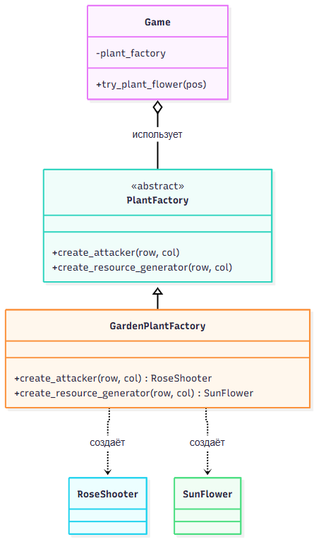
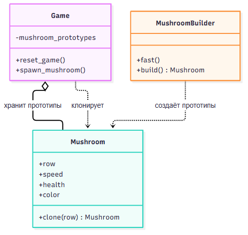
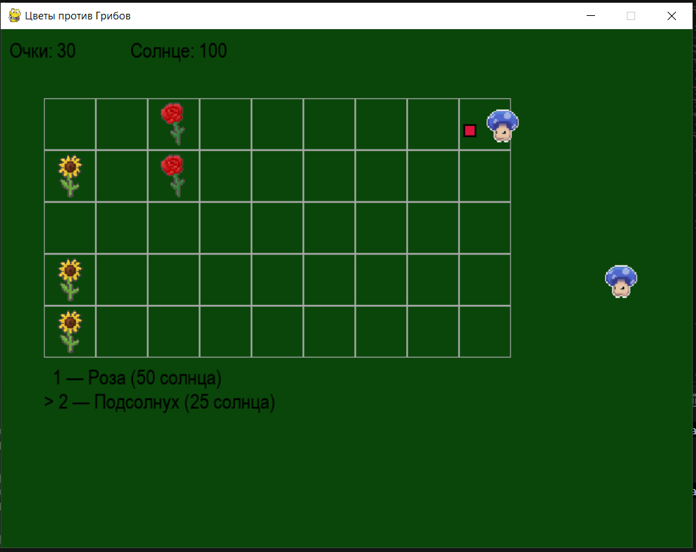

# Отчёт по лабораторной работе № 2

**Тема:** порождающие паттерны «Абстрактная фабрика», «Фабричный метод», «Прототип»

## Цель работы

Изучить порождающие паттерны «Абстрактная фабрика», «Фабричный метод» и «Прототип», а также применить два из них для решения задачи из предметной области.

## Вариант 16. Игра «Цветы против грибов»

Цель игры - не допустить прохода грибов к левому краю игрового поля. Для защиты игрок сажает растения: розы атакуют грибы, а подсолнухи производят ресурсы.

**Выбранные паттерны:** «Абстрактная фабрика» и «Прототип».

**Технологии:** Python 3.13.15, Pygame 2.6.1.

## Ход работы

### Паттерн «Абстрактная фабрика»

В игре есть два вида растений с разными ролями: `RoseShooter` атакует грибы, а `SunFlower` производит солнце для посадки новых растений. `PlantFactory` задаёт методы создания этих объектов, а `GardenPlantFactory` создаёт конкретные растения. Класс `Game` вызывает фабрику при посадке, поэтому не отвечает за непосредственное создание конкретных классов.



*Рисунок 1 - Диаграмма классов паттерна «Абстрактная фабрика».*

**Листинг 1 - Абстрактная фабрика растений.**

```python
class PlantFactory:
    """Интерфейс фабрики для создания игровых растений."""
    def create_attacker(self, row, col):
        raise NotImplementedError

    def create_resource_generator(self, row, col):
        raise NotImplementedError


class GardenPlantFactory(PlantFactory):
    def create_attacker(self, row, col):
        return RoseShooter(row, col)

    def create_resource_generator(self, row, col):
        return SunFlower(row, col)


...

class Game:
    def __init__(self):
        ...
        self.plant_factory = GardenPlantFactory()

    def try_plant_flower(self, pos):
        ...  # Проверка клетки, вычисление row, col и стоимости опущены.
        if self.selected_flower == "rose":
            new_flower = self.plant_factory.create_attacker(row, col)
        else:
            new_flower = self.plant_factory.create_resource_generator(row, col)

        self.sun -= cost
        self.grid[row][col] = new_flower
        self.entities.append(new_flower)
```

### Паттерн «Прототип»

Игра заранее создаёт два настроенных образца грибов: обычный и быстрый. Когда появляется новый гриб, `Game` случайно выбирает образец и вызывает `clone(row)`. Клон получает новый ряд, начальную позицию и полное здоровье, сохраняя скорость, цвет и остальные настройки прототипа.



*Рисунок 2 - Диаграмма классов паттерна «Прототип».*

**Листинг 2 - Клонирование гриба и использование прототипов.**

```python
import copy


class Mushroom(Entity):
    def __init__(self, row, speed=1.0, health=100):
        ...  # Инициализация полей гриба опущена.

    def clone(self, row):
        mushroom = copy.copy(self)
        mushroom.row = row
        mushroom.x = WIDTH
        mushroom.y = GRID_OFFSET_Y + row * CELL_SIZE + 5
        mushroom.health = self.health
        mushroom.is_alive = True
        mushroom.is_eating = False
        return mushroom


class Game:
    def reset_game(self):
        ...  # Сброс остального игрового состояния опущен.
        self.mushroom_prototypes = [
            MushroomBuilder(0).build(),
            MushroomBuilder(0).fast().build(),
        ]

    def spawn_mushroom(self):
        row = random.randint(0, GRID_ROWS - 1)
        prototype = random.choice(self.mushroom_prototypes)
        self.entities.append(prototype.clone(row))
```

### Результат работы программы



*Рисунок 3 - Игровое поле*

## Вывод

В ходе работы изучены три порождающих паттерна и реализованы два из них. «Абстрактная фабрика» создаёт растения разных игровых ролей через единый интерфейс. «Прототип» позволяет создавать новые экземпляры грибов копированием настроенных образцов.
