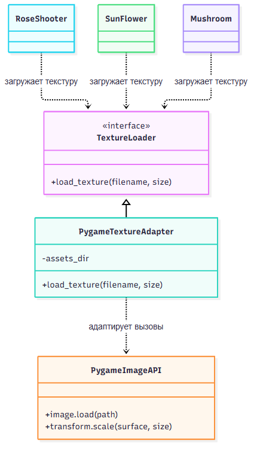
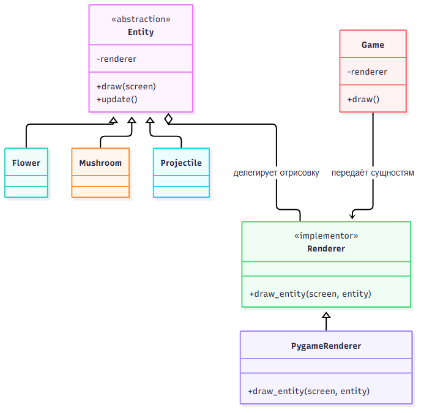

# Отчёт по лабораторной работе № 3

**Тема:** структурные паттерны «Адаптер» и «Мост»

## Цель работы

Реализовать решение задачи из предметной области в соответствии с вариантом с использованием паттернов «Адаптер» и «Мост».

## Вариант 16. Игра «Цветы против грибов»

Цель игры - не допустить прохода злых грибов, пытающихся захватить земли добрых растений, с помощью посадки защитных цветов.

**Технологии:** Python 3.13.15, Pygame 2.6.1.

## Ход работы

### Паттерн «Адаптер»

Pygame загружает изображение и масштабирует его отдельными вызовами. Игровым объектам нужен единый метод `load_texture(filename, size)`. Интерфейс `TextureLoader` задаёт этот метод, а `PygameTextureAdapter` переводит его вызов в операции `pygame.image.load()` и `pygame.transform.scale()`. Классы растений и грибов загружают текстуры через адаптер.



*Исходник Mermaid: [adapter-class-diagram.mmd](assets/adapter-class-diagram.mmd).*

*Рисунок 1 - Диаграмма классов паттерна «Адаптер».*

**Листинг 1 - Интерфейс загрузчика и адаптер Pygame.**

```python
class TextureLoader:
    def load_texture(self, filename, size):
        raise NotImplementedError


class PygameTextureAdapter(TextureLoader):
    def __init__(self, assets_dir):
        self.assets_dir = assets_dir

    def load_texture(self, filename, size):
        image = pygame.image.load(self.assets_dir / filename).convert_alpha()
        return pygame.transform.scale(image, size)


TEXTURE_LOADER = PygameTextureAdapter(TEXTURES_DIR)

class RoseShooter(Flower):
    def __init__(self, row, col, renderer=None):
        ...  # Настройка параметров розы опущена.
        self.texture = TEXTURE_LOADER.load_texture(
            "rose.png", (self.width, self.height)
        )
```

### Паттерн «Мост»

`Entity` задаёт общий способ отображения игровых объектов и делегирует отрисовку объекту `Renderer`. `PygameRenderer` реализует этот интерфейс средствами Pygame: выводит текстуру или, если её нет, рисует цветной прямоугольник. Иерархия игровых сущностей (`Flower`, `Mushroom`, `Projectile`) отделена от иерархии реализаций отрисовки.



*Исходник Mermaid: [bridge-class-diagram.mmd](assets/bridge-class-diagram.mmd).*

*Рисунок 2 - Диаграмма классов паттерна «Мост».*

**Листинг 2 - Делегирование отрисовки.**

```python
class Renderer:
    def draw_entity(self, screen, entity):
        raise NotImplementedError


class PygameRenderer(Renderer):
    def draw_entity(self, screen, entity):
        if entity.texture is not None:
            screen.blit(entity.texture, entity.get_rect())
        else:
            pygame.draw.rect(screen, entity.color, entity.get_rect())
            pygame.draw.rect(screen, BLACK, entity.get_rect(), 2)


class Entity:
    def __init__(self, x, y, width, height, color, health=100, renderer=None):
        # ... Инициализация координат и состояния сущности ...
        self.renderer = renderer or PygameRenderer()

    def draw(self, screen):
        self.renderer.draw_entity(screen, self)


class Game:
    def __init__(self):
        # ... Инициализация окна и игрового состояния ...
        self.renderer = PygameRenderer()
        self.plant_factory = GardenPlantFactory(self.renderer)
```


## Вывод

В игре реализованы паттерны «Адаптер» для загрузки текстур и «Мост» для отделения отрисовки от игровых сущностей.
