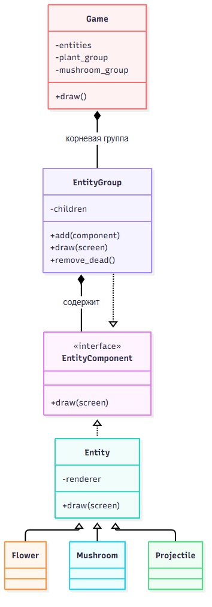
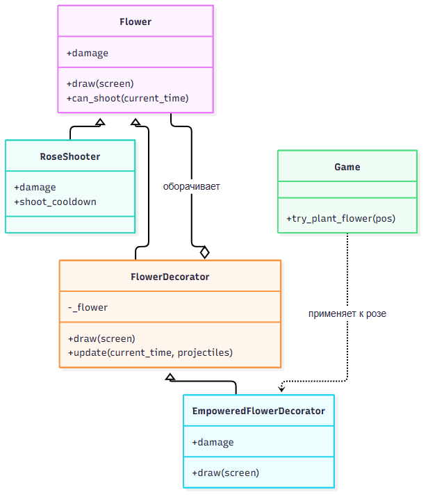
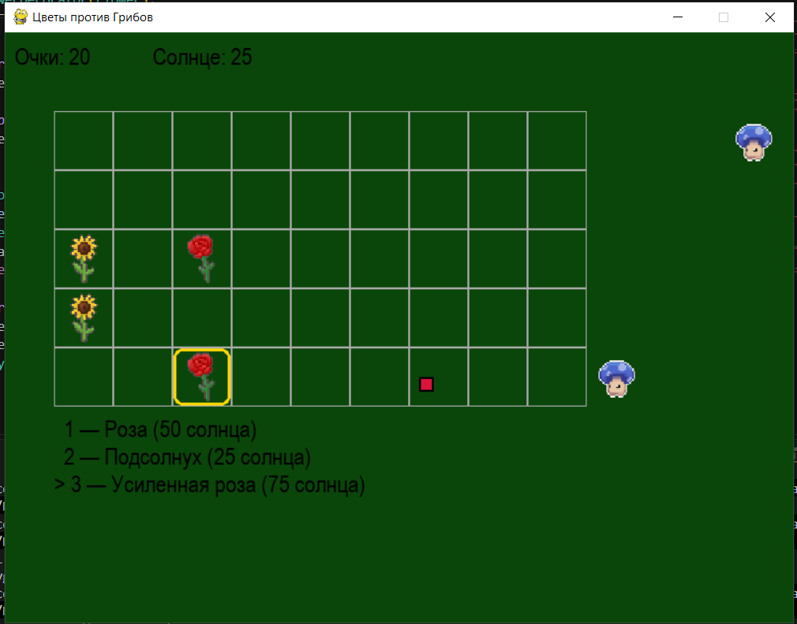

# Отчёт по лабораторной работе № 4

**Тема:** структурные паттерны «Компоновщик» и «Декоратор»

## Цель работы

Реализовать решение задачи из предметной области в соответствии с вариантом с использованием паттернов «Компоновщик» и «Декоратор».

## Вариант 16. Игра «Цветы против грибов»

Цель игры - не допустить прохода злых грибов, пытающихся захватить земли добрых растений, с помощью посадки защитных цветов.

**Технологии:** Python 3.13.15, Pygame 2.6.1.

## Ход работы

### Паттерн «Компоновщик»

Игровые объекты объединены в дерево компонентов. `Entity` и `EntityGroup` поддерживают общий интерфейс `EntityComponent`. Корневая группа хранит отдельные группы растений и грибов, поэтому отрисовать все игровые объекты можно одним вызовом `draw()`. При этом группа поддерживает вложенные группы, а игровой цикл может перебирать содержащиеся в них сущности.



*Рисунок 1 - Диаграмма классов паттерна «Компоновщик».*

Исходник Mermaid: [composite-class-diagram.mmd](assets/composite-class-diagram.mmd).

**Листинг 1 - Компонент и компоновщик игровых сущностей.**

```python
class EntityComponent:
    def draw(self, screen):
        raise NotImplementedError


class EntityGroup(EntityComponent):
    def __init__(self):
        self.children = []

    def add(self, component):
        self.children.append(component)

    def __iter__(self):
        for child in self.children:
            if isinstance(child, EntityGroup):
                yield from child
            else:
                yield child

    def draw(self, screen):
        for child in self.children:
            child.draw(screen)

    def remove_dead(self):
        remaining = []
        for child in self.children:
            if isinstance(child, EntityGroup):
                child.remove_dead()
                remaining.append(child)
            elif child.is_alive:
                remaining.append(child)
        self.children = remaining


class Game:
    def reset_game(self):
        # ... Сбрасываются остальные игровые данные ...
        self.entities = EntityGroup()
        self.plant_group = EntityGroup()
        self.mushroom_group = EntityGroup()
        self.entities.add(self.plant_group)
        self.entities.add(self.mushroom_group)

    def draw(self):
        # ... Отрисовывается игровое поле ...
        self.entities.draw(self.screen)
```

### Паттерн «Декоратор»

`FlowerDecorator` оборачивает обычный цветок и сохраняет интерфейс `Flower`. `EmpoweredFlowerDecorator` удваивает урон розы и рисует вокруг неё золотую рамку, не изменяя исходный класс `RoseShooter`. В игре усиленная роза выбирается клавишей **3** и стоит 75 единиц солнца.



*Рисунок 2 - Диаграмма классов паттерна «Декоратор».*

Исходник Mermaid: [decorator-class-diagram.mmd](assets/decorator-class-diagram.mmd).

**Листинг 2 - Декоратор усиленной розы.**

```python
class FlowerDecorator(Flower):
    def __init__(self, flower):
        object.__setattr__(self, "_flower", flower)

    def __getattr__(self, name):
        return getattr(self._flower, name)

    def __setattr__(self, name, value):
        if name == "_flower":
            object.__setattr__(self, name, value)
        else:
            setattr(self._flower, name, value)

    def draw(self, screen):
        self._flower.draw(screen)

    def update(self, current_time, projectiles):
        self._flower.update(current_time, projectiles)


class EmpoweredFlowerDecorator(FlowerDecorator):
    @property
    def damage(self):
        return self._flower.damage * 2

    def draw(self, screen):
        self._flower.draw(screen)
        rect = self._flower.get_rect()
        pygame.draw.rect(
            screen,
            (255, 215, 0),
            rect.inflate(8, 8),
            width=3,
            border_radius=9,
        )


# ... В Game.try_plant_flower() ...
rose = self.plant_factory.create_attacker(row, col)
new_flower = EmpoweredFlowerDecorator(rose)
```

### Результат работы программы



*Рисунок 3 - Растения защищают поле от грибов.*

## Вывод

В игре применены «Компоновщик» для группировки игровых сущностей и «Декоратор» для усиления розы.
