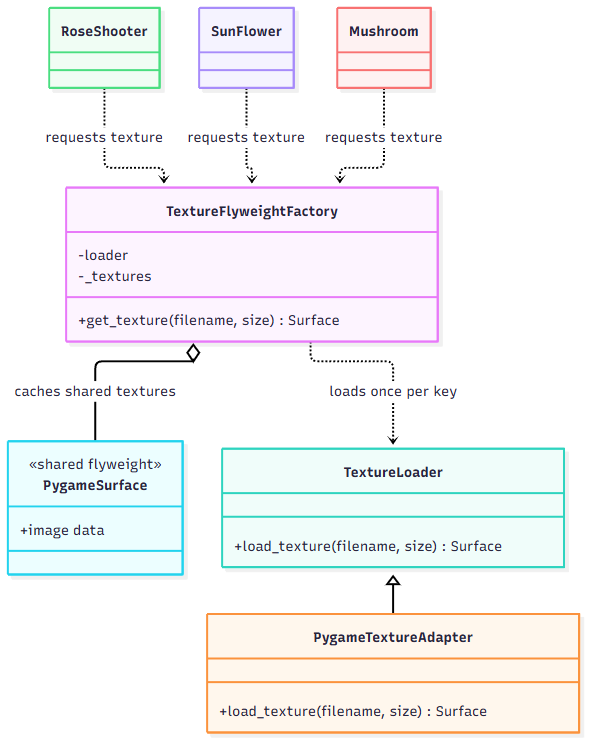
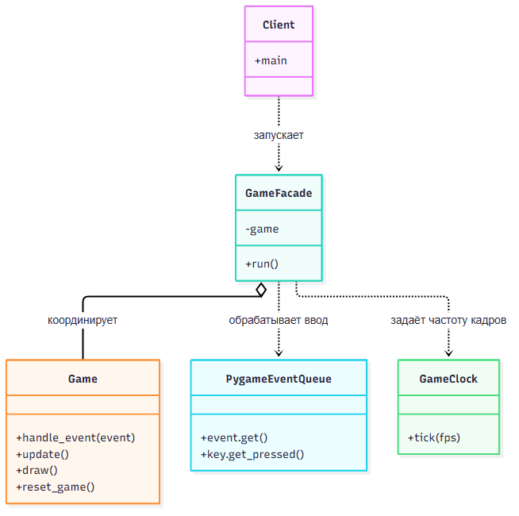

# Отчёт по лабораторной работе № 5

**Тема:** структурные паттерны «Фасад» и «Приспособленец»

## Цель работы

Реализовать решение задачи из предметной области в соответствии с вариантами (пп. 1.4) с использованием паттернов из списка: «Фасад», «Приспособленец».

## Вариант 16. Игра «Цветы против грибов»

Цель игры - не допустить прохода злых грибов, пытающихся захватить земли добрых растений, с помощью посадки защитных цветов.

**Технологии:** Python 3.13.15, Pygame 2.6.1.

## Ход работы

### Паттерн «Приспособленец»

Текстуры повторно используются многими игровыми объектами. `TextureFlyweightFactory` хранит загруженные изображения в кэше по имени файла и размеру. При повторном запросе фабрика возвращает уже загруженную текстуру, а не создаёт новую. Загрузку выполняет `TextureLoader`, реализованный адаптером Pygame.



*Рисунок 1 - Диаграмма классов паттерна «Приспособленец».*

Исходник Mermaid: [flyweight-class-diagram.mmd](assets/flyweight-class-diagram.mmd).

**Листинг 1 - Кэширование общих текстур.**

```python
class TextureFlyweightFactory:
    def __init__(self, loader):
        self.loader = loader
        self._textures = {}

    def get_texture(self, filename, size):
        key = (filename, tuple(size))
        if key not in self._textures:
            self._textures[key] = self.loader.load_texture(filename, size)
        return self._textures[key]


TEXTURE_FLYWEIGHTS = TextureFlyweightFactory(TEXTURE_LOADER)

# ... Игровые объекты получают текстуры через общий кэш ...
self.texture = TEXTURE_FLYWEIGHTS.get_texture(
    "rose.png", (self.width, self.height)
)
```

### Паттерн «Фасад»

`GameFacade` предоставляет приложению единый метод `run()`. За ним скрыта координация очереди событий Pygame, обновления игрового состояния, отрисовки кадра и ограничения частоты кадров. Поэтому точка входа запускает игру через фасад, не вызывая эти подсистемы отдельно.



*Рисунок 2 - Диаграмма классов паттерна «Фасад».*

Исходник Mermaid: [facade-class-diagram.mmd](assets/facade-class-diagram.mmd).

**Листинг 2 - Единый интерфейс игрового цикла.**

```python
class GameFacade:
    def __init__(self, game=None):
        self.game = game or Game()

    def run(self):
        running = True
        while running:
            for event in pygame.event.get():
                if event.type == pygame.QUIT:
                    running = False
                    break
                self.game.handle_event(event)

            if not running:
                break

            keys = pygame.key.get_pressed()
            if keys[pygame.K_r] and self.game.game_over:
                self.game.reset_game()

            self.game.update()
            self.game.draw()
            self.game.clock.tick(FPS)

        pygame.quit()


# Точка входа
GameFacade().run()
```

## Вывод

В игре «Приспособленец» повторно использует текстуры, а «Фасад» предоставляет единый способ запуска игрового цикла.
