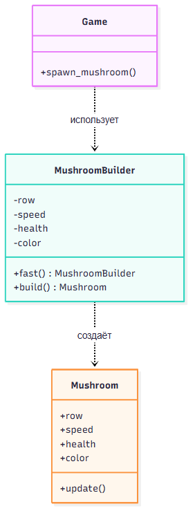
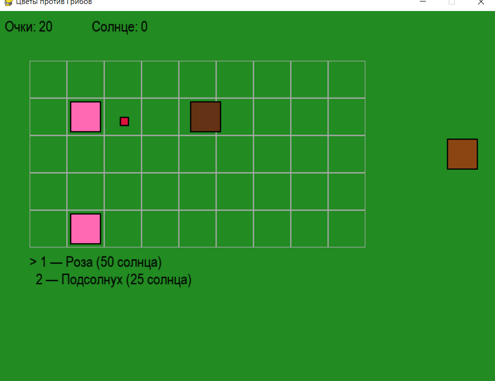

# Отчёт по лабораторной работе № 1

**Тема:** порождающие паттерны «Одиночка» и «Строитель»


## Цель работы

Изучить порождающие паттерны «Одиночка» и «Строитель» и использовать их для решения практических задач.

## Вариант 16. Игра "Цветы против грибов"

Цель игры - не допустить прохода злых грибов, пытающихся захватить земли добрых растений, с помощью посадки защитных цветов.

**Технологии:** Python 3.13.15, Pygame 2.6.1.

## Ход работы

### Паттерн «Строитель»

У гриба есть несколько характеристик: ряд на игровом поле, скорость, здоровье и цвет. Для обычного гриба используются значения по умолчанию, а для быстрого меняются скорость, здоровье и цвет. Поэтому гриб собирается с помощью `MushroomBuilder`: он задаёт нужные параметры и создаёт готовый объект.



*Рисунок 2 - Диаграмма классов паттерна «Строитель».*

### Исходный код

**Листинг 1 — Строитель MushroomBuilder и его использование.**

В Markdown код удобно оформлять fenced-блоком с указанием языка: он остаётся текстом, копируется и подсвечивается как Python. В листинг включены строитель и место, где игра собирает прототипы грибов; остальной код обозначен многоточиями.

```python
# ... Класс Mushroom и другие сущности игры ...

class MushroomBuilder:
    """Пошагово настраивает характеристики гриба."""
    def __init__(self, row):
        self.row = row
        self.speed = 0.8
        self.health = 100
        self.color = BROWN

    def fast(self):
        self.speed = 1.8
        self.health = 60
        self.color = (100, 50, 20)
        return self

    def build(self):
        mushroom = Mushroom(self.row, speed=self.speed, health=self.health)
        mushroom.color = self.color
        return mushroom


# ... Другие классы игры ...

class Game:
    def reset_game(self):
        # ... Инициализация состояния игры ...

        # Строитель задаёт параметры двух типов грибов.
        self.mushroom_prototypes = [
            MushroomBuilder(0).build(),
            MushroomBuilder(0).fast().build(),
        ]

    # ... Остальные методы класса Game ...
```

### Результат работы программы



*Рисунок 3 - Быстрый тёмный и медленный светлый гриб.*

## Вывод

В ходе работы изучены порождающие паттерны «Одиночка» и «Строитель». Паттерн «Строитель» использован в игре для создания грибов.
