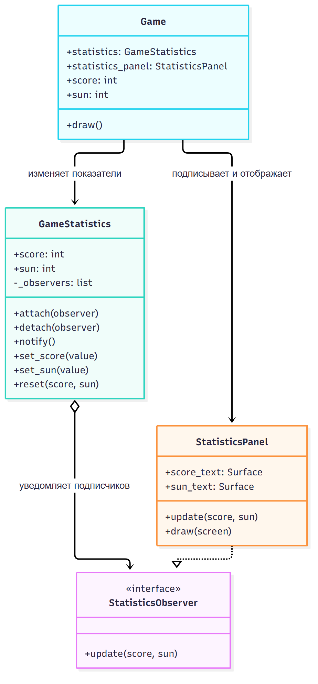
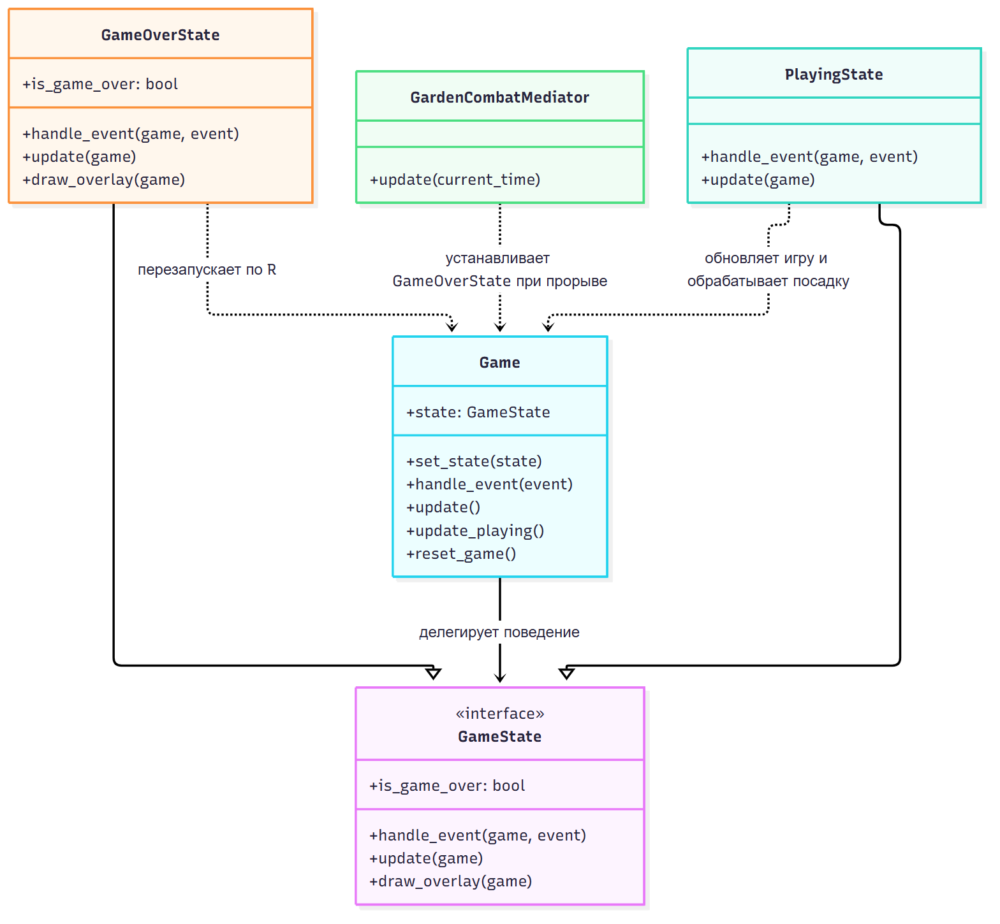

# Отчёт по лабораторной работе № 10

**Тема:** поведенческие паттерны «Наблюдатель» и «Состояние»

## Цель работы

Реализовать решение задачи из предметной области в соответствии с вариантами (пп. 1.4) с использованием паттернов из списка: «Наблюдатель», «Состояние».

## Вариант 16. Игра «Цветы против грибов»

Цель игры - не допустить прохода злых грибов, пытающихся захватить земли добрых растений, с помощью посадки защитных цветов.

**Технологии:** Python 3.13.15, Pygame 2.6.1.

## Ход работы

### Паттерн «Наблюдатель»

**Теория.** Наблюдатель связывает издателя с подписчиками. Издатель ведёт список подписчиков и уведомляет их об изменении состояния или наступлении события. Каждый подписчик сам определяет, как реагировать, и может подключаться или отключаться независимо от остальных.

Количество солнца меняется при посадке и работе подсолнухов, а очки начисляются за уничтожение грибов. Панель интерфейса должна показывать актуальные значения после каждого изменения, в том числе после перезапуска партии и восстановления снимка. Для этого `GameStatistics` хранит показатели и список подписчиков. При изменении значения издатель вызывает `notify()`, а каждый подписчик получает новые показатели через `update(score, sun)`.

`StatisticsObserver` задаёт интерфейс наблюдателя. Конкретный наблюдатель `StatisticsPanel` формирует изображения надписей «Очки» и «Солнце» после уведомления. При отрисовке кадра игра выводит уже подготовленные изображения. Метод `attach()` подключает подписчика и сразу передаёт ему текущие значения, а `detach()` отключает его от уведомлений.

Свойства `Game.score` и `Game.sun` передают изменения издателю. Поэтому существующие операции начисления очков и расходования солнца уведомляют интерфейс. Метод `GameStatistics.reset()` устанавливает оба показателя и рассылает одно уведомление; он используется при сбросе игры и восстановлении снимка. Издатель обращается к подписчикам через общий интерфейс, поэтому к нему можно подключить дополнительные наблюдатели.



*Рисунок 1 - Диаграмма классов паттерна «Наблюдатель».*

Исходник Mermaid: [observer-class-diagram.mmd](../assets/observer-class-diagram.mmd).

**Листинг 1 - Издатель, интерфейс наблюдателя и панель показателей.**

```python
class StatisticsObserver:
    """Интерфейс подписчика на изменения игровых показателей."""
    def update(self, score, sun):
        raise NotImplementedError


class GameStatistics:
    """Издатель: хранит показатели и уведомляет подписчиков об изменениях."""
    def __init__(self):
        self.score = 0
        self.sun = 100
        self._observers = []

    def attach(self, observer):
        if observer not in self._observers:
            self._observers.append(observer)
            observer.update(self.score, self.sun)

    def detach(self, observer):
        if observer in self._observers:
            self._observers.remove(observer)

    def notify(self):
        for observer in tuple(self._observers):
            observer.update(self.score, self.sun)

    def set_score(self, value):
        if self.score != value:
            self.score = value
            self.notify()

    def set_sun(self, value):
        if self.sun != value:
            self.sun = value
            self.notify()

    def reset(self, score=0, sun=100):
        self.score = score
        self.sun = sun
        self.notify()


class StatisticsPanel(StatisticsObserver):
    """Обновляет изображения надписей после уведомления издателя."""
    def __init__(self, font):
        self.font = font
        self.score_text = None
        self.sun_text = None

    def update(self, score, sun):
        self.score_text = self.font.render(f"Очки: {score}", True, BLACK)
        self.sun_text = self.font.render(f"Солнце: {sun}", True, BLACK)

    def draw(self, screen):
        screen.blit(self.score_text, (10, 10))
        screen.blit(self.sun_text, (150, 10))
```

**Листинг 2 - Подключение наблюдателя и изменение показателей.**

```python
class Game:
    def __init__(self):
        # ... Инициализация Pygame, окна и шрифта ...
        self.statistics = GameStatistics()
        self.statistics_panel = StatisticsPanel(self.font)
        self.statistics.attach(self.statistics_panel)
        # ... Инициализация остальных объектов игры ...

    @property
    def score(self):
        return self.statistics.score

    @score.setter
    def score(self, value):
        self.statistics.set_score(value)

    @property
    def sun(self):
        return self.statistics.sun

    @sun.setter
    def sun(self, value):
        self.statistics.set_sun(value)

    def draw(self):
        # ... Отрисовка поля и сущностей ...
        self.statistics_panel.draw(self.screen)
        # ... Отрисовка остальных элементов интерфейса ...


# ... В PlantingProxy.place() после успешной посадки ...
self.game.sun -= request.cost

# ... В GardenCombatMediator.update() при уничтожении гриба ...
self.game.score += 10
```

### Паттерн «Состояние»

**Теория.** Состояние позволяет объекту менять поведение при изменении внутреннего состояния. Для каждого состояния создаётся отдельный класс с общим интерфейсом. Основной объект передаёт операции текущему состоянию, а при переходе заменяет его другим.

Во время игры разрешены выбор растений, посадка и обновление боя. После прорыва гриба бой останавливается, появляется сообщение о проигрыше и становится доступен перезапуск клавишей R. Такое различие в поведении представлено двумя классами состояний: `PlayingState` и `GameOverState`, которые реализуют общий интерфейс `GameState`.

`Game` хранит текущий объект в поле `state` и делегирует ему обработку игровых событий, обновление и вывод сообщения поверх поля. `PlayingState` обрабатывает выбор и посадку растений, а для обновления вызывает `Game.update_playing()`. `GameOverState` не обновляет бой, отображает сообщение о проигрыше и запускает новую партию при нажатии R.

Когда гриб проходит левую границу поля, посредник вызывает `set_state(GameOverState())`. Метод `reset_game()` устанавливает `PlayingState`. Свойство `game_over` получает значение из текущего состояния и сохраняет совместимость с проверками посадки и снимками. При восстановлении снимка игра выбирает состояние по сохранённому признаку проигрыша. Общие клавиши F5 и F9 обрабатываются в `Game` до передачи события состоянию, поэтому доступны в обоих режимах.



*Рисунок 2 - Диаграмма классов паттерна «Состояние».*

Исходник Mermaid: [state-class-diagram.mmd](../assets/state-class-diagram.mmd).

**Листинг 3 - Интерфейс состояния и конкретные состояния игры.**

```python
class GameState:
    """Интерфейс поведения игры в текущем состоянии."""
    is_game_over = False

    def handle_event(self, game, event):
        raise NotImplementedError

    def update(self, game):
        raise NotImplementedError

    def draw_overlay(self, game):
        pass


class PlayingState(GameState):
    def handle_event(self, game, event):
        if event.type == pygame.MOUSEBUTTONDOWN and event.button == 1:
            game.try_plant_flower(event.pos)
        elif event.type == pygame.KEYDOWN:
            if event.key == pygame.K_1:
                game.selected_flower = "rose"
            elif event.key == pygame.K_2:
                game.selected_flower = "sunflower"
            elif event.key == pygame.K_3:
                game.selected_flower = "empowered_rose"

    def update(self, game):
        game.update_playing()


class GameOverState(GameState):
    is_game_over = True

    def handle_event(self, game, event):
        if event.type == pygame.KEYDOWN and event.key == pygame.K_r:
            game.reset_game()

    def update(self, game):
        pass

    def draw_overlay(self, game):
        text = game.font.render(
            "GAME OVER! Грибы прорвались. Нажмите R для рестарта.", True, RED
        )
        game.screen.blit(text, (WIDTH // 2 - 250, HEIGHT // 2))
```

**Листинг 4 - Делегирование поведения и переходы между состояниями.**

```python
class Game:
    def set_state(self, state):
        self.state = state

    @property
    def game_over(self):
        return self.state.is_game_over

    @game_over.setter
    def game_over(self, value):
        self.set_state(GameOverState() if value else PlayingState())

    def reset_game(self):
        # ... Сброс поля, групп и показателей ...
        self.set_state(PlayingState())
        # ... Подготовка прототипов грибов и таймеров ...

    def handle_event(self, event):
        # ... Общая обработка F5 и F9 с возвратом после сохранения/загрузки ...
        self.state.handle_event(self, event)

    def update(self):
        self.state.update(self)

    def update_playing(self):
        # ... Создание грибов по таймеру и обновление боя через посредника ...
        # ... Удаление погибших сущностей ...
        ...

    def draw(self):
        # ... Отрисовка игрового поля, сущностей и интерфейса ...
        self.state.draw_overlay(self)
        pygame.display.flip()


# ... В GardenCombatMediator.update() ...
if entity.x < GRID_OFFSET_X:
    self.game.set_state(GameOverState())

# ... В Game.restore_snapshot() ...
self.set_state(GameOverState() if state["game_over"] else PlayingState())
```

## Вывод

В игре «Наблюдатель» обновляет панель показателей при изменении очков и солнца, а «Состояние» определяет поведение во время игры и после проигрыша.
