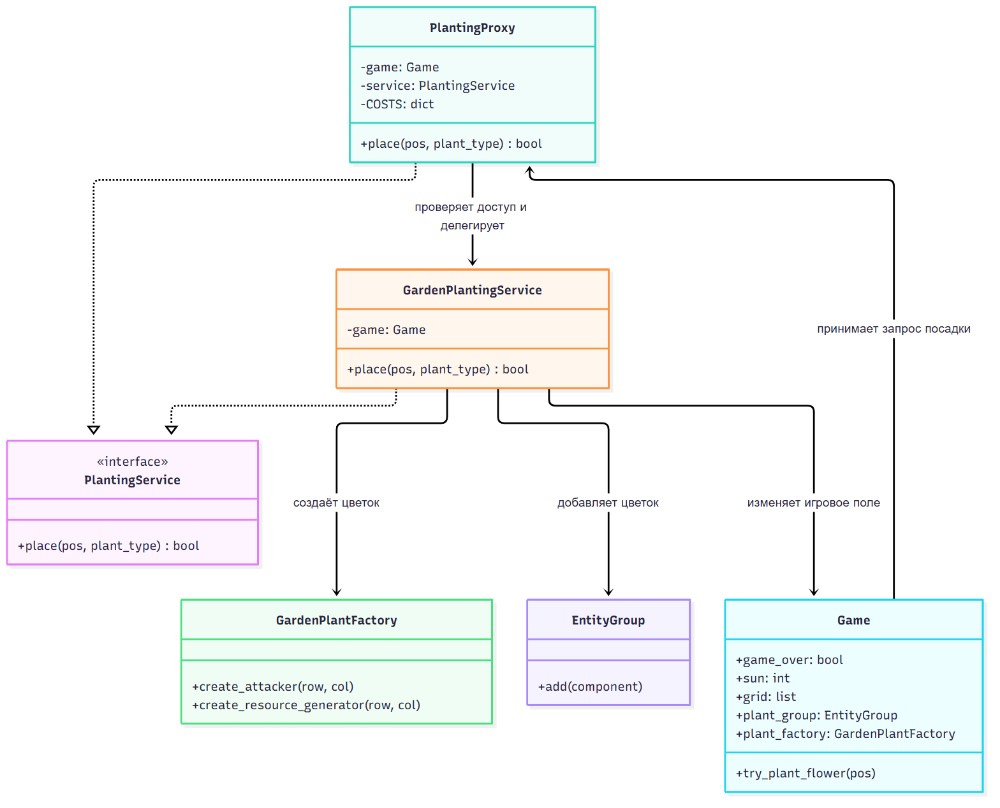

# Отчёт по лабораторной работе № 6

**Тема:** структурный паттерн «Заместитель»

## Цель работы

Реализовать решение задачи из предметной области в соответствии с вариантами (пп. 1.4) с использованием паттерна «Заместитель».

## Вариант 16. Игра «Цветы против грибов»

Цель игры - не допустить прохода злых грибов, пытающихся захватить земли добрых растений, с помощью посадки защитных цветов.

**Технологии:** Python 3.13.15, Pygame 2.6.1.

## Ход работы

### Паттерн «Заместитель»

**Теория.** Заместитель - объект, через который клиент обращается к другому объекту. Он предоставляет тот же интерфейс и управляет обращениями к оригиналу. Например, он может проверить право доступа перед вызовом операции или создать оригинал при первом обращении.

В игре посадка растения доступна только при выполнении игровых условий: игра должна продолжаться, выбранная клетка должна находиться на поле и быть свободной, а у игрока должно хватать солнца. `PlantingProxy` проверяет эти условия перед вызовом операции. Если проверка проходит, он передаёт запрос `GardenPlantingService`, который создаёт растение через фабрику, размещает его на поле и в группе растений. Стоимость списывается заместителем после успешной посадки.

`PlantingProxy` и `GardenPlantingService` реализуют общий интерфейс `PlantingService`. Класс `Game` обращается к заместителю, не вызывая сервис напрямую. Таким образом заместитель контролирует доступ к посадке. Приспособленец из лабораторной работы 5 отвечает за совместное использование текстур. Задача заместителя - разрешать или отклонять игровую операцию. Одинаковый интерфейс позволяет передавать запрос посадки как сервису, так и его заместителю.

Исходник Mermaid: [proxy-class-diagram.mmd](../assets/proxy-class-diagram.mmd).



*Рисунок 1 - Диаграмма классов паттерна «Заместитель».*

**Листинг 1 - Проверка доступа и выполнение посадки.**

```python
class PlantingService:
    def place(self, pos, plant_type):
        raise NotImplementedError


class GardenPlantingService(PlantingService):
    def __init__(self, game):
        self.game = game

    def place(self, pos, plant_type):
        mx, my = pos
        col = (mx - GRID_OFFSET_X) // CELL_SIZE
        row = (my - GRID_OFFSET_Y) // CELL_SIZE

        if plant_type == "rose":
            plant = self.game.plant_factory.create_attacker(row, col)
        elif plant_type == "sunflower":
            plant = self.game.plant_factory.create_resource_generator(row, col)
        elif plant_type == "empowered_rose":
            rose = self.game.plant_factory.create_attacker(row, col)
            plant = EmpoweredFlowerDecorator(rose)
        else:
            return False

        self.game.grid[row][col] = plant
        self.game.plant_group.add(plant)
        return True


class PlantingProxy(PlantingService):
    COSTS = {"rose": 50, "sunflower": 25, "empowered_rose": 75}

    def __init__(self, game, service):
        self.game = game
        self.service = service

    def place(self, pos, plant_type):
        if self.game.game_over:
            return False

        mx, my = pos
        col = (mx - GRID_OFFSET_X) // CELL_SIZE
        row = (my - GRID_OFFSET_Y) // CELL_SIZE

        if not (0 <= row < GRID_ROWS and 0 <= col < GRID_COLS):
            return False
        if self.game.grid[row][col] is not None:
            return False

        cost = self.COSTS.get(plant_type)
        if cost is None or self.game.sun < cost:
            return False

        if not self.service.place(pos, plant_type):
            return False
        self.game.sun -= cost
        return True
```

`Game` создаёт сервис и его заместителя, а `try_plant_flower()` передаёт запрос через общий интерфейс:

```python
class Game:
    def __init__(self):
        # ... Инициализация окна и фабрики растений ...
        self.planting_service = GardenPlantingService(self)
        self.planting_proxy = PlantingProxy(self, self.planting_service)
        self.reset_game()

    def try_plant_flower(self, pos):
        return self.planting_proxy.place(pos, self.selected_flower)

    # ... Остальные методы игры ...
```

## Вывод

В игре реализован защитный заместитель, который проверяет игровые условия перед посадкой и делегирует создание растения сервису.
