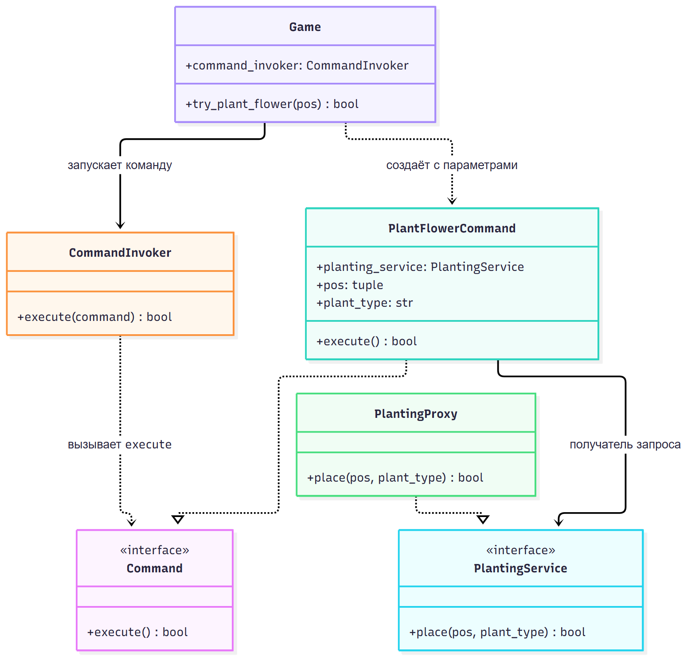
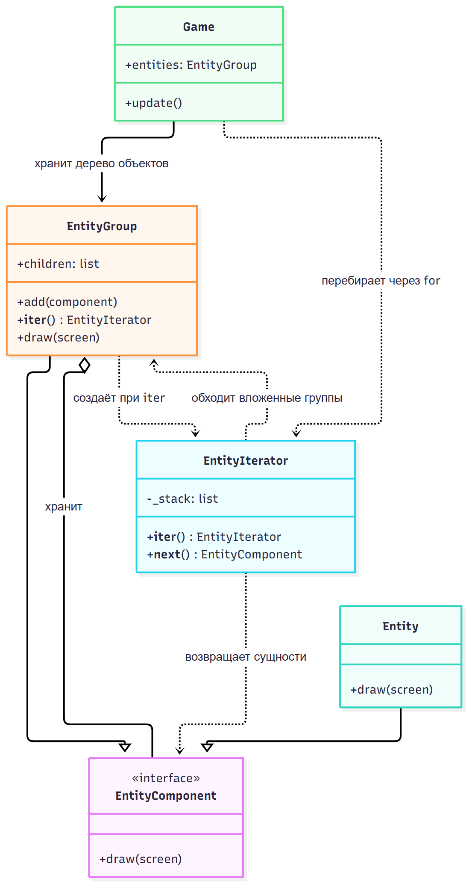

# Отчёт по лабораторной работе № 7

**Тема:** поведенческие паттерны «Команда» и «Итератор»

## Цель работы

Реализовать решение задачи из предметной области в соответствии с вариантами (пп. 1.4) с использованием паттернов из списка: «Команда», «Итератор / Индикатор».

## Вариант 16. Игра «Цветы против грибов»

Цель игры - не допустить прохода злых грибов, пытающихся захватить земли добрых растений, с помощью посадки защитных цветов.

**Технологии:** Python 3.13.15, Pygame 2.6.1.

## Ход работы

### Паттерн «Команда»

**Теория.** Команда представляет запрос на выполнение действия отдельным объектом. Она хранит параметры запроса и при необходимости ссылку на получателя. Инициатор запускает действие через общий метод, поэтому один и тот же код может выполнять разные команды. Команды можно отложить или поставить в очередь.

При щелчке по полю игрок запрашивает посадку выбранного растения. Для выполнения действия нужны координаты щелчка, тип растения и сервис посадки. Эти данные объединены в объекте `PlantFlowerCommand`. Команда сохраняет их при создании, а её метод `execute()` передаёт запрос получателю через интерфейс `PlantingService`.

`Game.try_plant_flower()` создаёт команду и передаёт её инициатору `CommandInvoker`, который запускает её через общий интерфейс `Command`. Получателем служит защитный заместитель `PlantingProxy` из лабораторной работы 6. Он проверяет игровые условия и передаёт успешный запрос сервису посадки. Результат выполнения возвращается вызывающему коду.



*Рисунок 1 - Диаграмма классов паттерна «Команда».*

Исходник Mermaid: [command-class-diagram.mmd](../assets/command-class-diagram.mmd).

**Листинг 1 - Команда посадки и инициатор.**

```python
class Command:
    """Общий интерфейс игровых команд."""
    def execute(self):
        raise NotImplementedError


class PlantFlowerCommand(Command):
    """Хранит получателя и параметры одного запроса посадки."""
    def __init__(self, planting_service, pos, plant_type):
        self.planting_service = planting_service
        self.pos = tuple(pos)
        self.plant_type = plant_type

    def execute(self):
        return self.planting_service.place(self.pos, self.plant_type)


class CommandInvoker:
    """Запускает игровые действия через общий интерфейс команд."""
    def execute(self, command):
        return command.execute()
```

**Листинг 2 - Использование команды в игре.**

```python
class Game:
    def __init__(self):
        # ... Инициализация окна и фабрики растений ...
        self.planting_service = GardenPlantingService(self)
        self.planting_proxy = PlantingProxy(self, self.planting_service)
        self.command_invoker = CommandInvoker()
        self.reset_game()

    def handle_event(self, event):
        if event.type == pygame.MOUSEBUTTONDOWN and not self.game_over:
            if event.button == 1:
                self.try_plant_flower(event.pos)
        # ... Обработка клавиш выбора растения ...

    def try_plant_flower(self, pos):
        command = PlantFlowerCommand(
            self.planting_proxy, pos, self.selected_flower
        )
        return self.command_invoker.execute(command)

    # ... Остальные методы игры ...
```

### Паттерн «Итератор»

**Теория.** Итератор последовательно выдаёт элементы коллекции и хранит текущую позицию обхода. Клиент запрашивает следующий элемент через общий интерфейс и может одинаково обходить коллекции с разным внутренним устройством. Несколько итераторов могут обходить одну коллекцию независимо.

Сущности игры находятся во вложенных группах: корневая группа содержит группы растений и грибов. Игровому циклу нужно последовательно получать отдельные сущности для обновления, поиска целей и проверки столкновений. Для этого создан `EntityIterator`, который обходит дерево в глубину и скрывает его внутреннее устройство от игрового цикла.

Итератор хранит стек обхода. При встрече вложенной группы он переходит к её содержимому, а при исчерпании группы возвращается к предыдущему уровню. Сами группы пропускаются; отдельные сущности возвращаются в порядке добавления. После окончания обхода `__next__()` вызывает `StopIteration`.

Метод `EntityGroup.__iter__()` каждый раз создаёт новый итератор. Поэтому внешний цикл обновления и вложенный поиск целей работают независимо и не изменяют положение друг друга. Обход рассчитан на дерево групп; очистка погибших сущностей выполняется после завершения обхода.



*Рисунок 2 - Диаграмма классов паттерна «Итератор».*

Исходник Mermaid: [iterator-class-diagram.mmd](../assets/iterator-class-diagram.mmd).

**Листинг 3 - Итератор дерева игровых сущностей.**

```python
class EntityIterator:
    """Обходит дерево групп в глубину и возвращает отдельные сущности."""
    def __init__(self, group):
        self._stack = [iter(group.children)]

    def __iter__(self):
        return self

    def __next__(self):
        while self._stack:
            try:
                child = next(self._stack[-1])
            except StopIteration:
                self._stack.pop()
                continue

            if isinstance(child, EntityGroup):
                self._stack.append(iter(child.children))
            else:
                return child
        raise StopIteration

class EntityGroup(EntityComponent):
    def __init__(self):
        self.children = []

    def add(self, component):
        self.children.append(component)

    def __iter__(self):
        return EntityIterator(self)

    # ... Отрисовка группы и удаление погибших сущностей ...
```

**Листинг 4 - Использование итератора при поиске цели.**

```python
# ... В методе Game.update() ...
for entity in self.entities:
    # ... Обновление сущности ...
    if isinstance(entity, Flower) and entity.damage > 0 and entity.can_shoot(current_time):
        has_target = any(
            isinstance(e, Mushroom) and e.row == entity.row and e.x > entity.x
            for e in self.entities
        )
        if has_target:
            # ... Создание снаряда и сохранение времени выстрела ...
            ...
    # ... Движение грибов и обработка столкновений ...
```

## Вывод

В игре «Команда» представляет запрос посадки отдельным объектом, а «Итератор» обеспечивает последовательный обход сущностей во вложенных группах.
