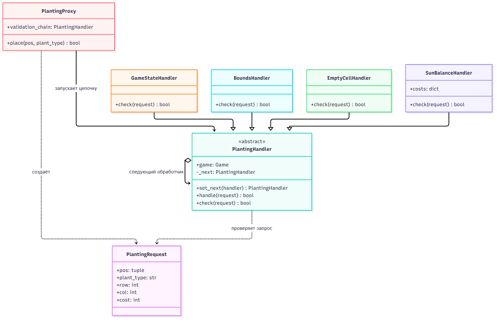

# Отчёт по лабораторной работе № 8

**Тема:** поведенческий паттерн «Цепочка обязанностей»

## Цель работы

Реализовать решение задачи из предметной области в соответствии с вариантами (пп. 1.4) с использованием паттерна «Цепочка обязанностей».

## Вариант 16. Игра «Цветы против грибов»

Цель игры - не допустить прохода злых грибов, пытающихся захватить земли добрых растений, с помощью посадки защитных цветов.

**Технологии:** Python 3.13.15, Pygame 2.6.1.

## Ход работы

### Паттерн «Цепочка обязанностей»

Перед посадкой растения необходимо проверить несколько условий: игра должна продолжаться, координаты должны попадать в границы поля, клетка должна быть свободной, а у игрока должно хватать солнца на выбранное растение. Эти проверки выполняются последовательно, причём при первом отказе обработку запроса нужно прекратить. Поэтому каждая проверка оформлена отдельным обработчиком, а обработчики связаны в цепочку.

Объект `PlantingRequest` хранит координаты, тип растения, вычисленные ряд и столбец, а также стоимость посадки. Базовый класс `PlantingHandler` задаёт методы `set_next()`, `handle()` и `check()`. Метод `handle()` запускает собственную проверку, при отказе возвращает `False`, а при успехе передаёт тот же запрос следующему обработчику. Если последний обработчик успешно завершил проверку, цепочка возвращает `True`.

Проверки выполняются в следующем порядке:

1. `GameStateHandler` отклоняет посадку после окончания игры.
2. `BoundsHandler` проверяет ряд и столбец. Это позволяет безопасно обратиться к сетке на следующем шаге.
3. `EmptyCellHandler` проверяет, что выбранная клетка свободна.
4. `SunBalanceHandler` проверяет тип растения и баланс солнца, затем записывает стоимость в запрос.

`PlantingProxy` из лабораторной работы 6 создаёт запрос и запускает цепочку. После успешного прохождения всех проверок заместитель вызывает сервис посадки и списывает стоимость только при успешном создании растения. Условия вынесены в отдельные классы: новую проверку можно добавить в цепочку через `set_next()`. Обработчики хранят ссылку на игру и при каждом вызове читают её текущее состояние, поэтому цепочка работает и после перезапуска.



*Рисунок 1 - Диаграмма классов паттерна «Цепочка обязанностей».*

Исходник Mermaid: [chain-of-responsibility-class-diagram.mmd](../assets/chain-of-responsibility-class-diagram.mmd).

**Листинг 1 - Запрос посадки и обработчики цепочки.**

```python
class PlantingRequest:
    """Данные одной попытки посадки, передаваемые по цепочке проверок."""
    def __init__(self, pos, plant_type):
        self.pos = tuple(pos)
        self.plant_type = plant_type
        self.col = (self.pos[0] - GRID_OFFSET_X) // CELL_SIZE
        self.row = (self.pos[1] - GRID_OFFSET_Y) // CELL_SIZE
        self.cost = 0


class PlantingHandler:
    """Проверяет своё условие и передаёт допустимый запрос дальше."""
    def __init__(self, game):
        self.game = game
        self._next = None

    def set_next(self, handler):
        self._next = handler
        return handler

    def handle(self, request):
        if not self.check(request):
            return False
        if self._next is not None:
            return self._next.handle(request)
        return True

    def check(self, request):
        raise NotImplementedError


class GameStateHandler(PlantingHandler):
    def check(self, request):
        return not self.game.game_over


class BoundsHandler(PlantingHandler):
    def check(self, request):
        return (0 <= request.row < GRID_ROWS
                and 0 <= request.col < GRID_COLS)


class EmptyCellHandler(PlantingHandler):
    def check(self, request):
        return self.game.grid[request.row][request.col] is None


class SunBalanceHandler(PlantingHandler):
    def __init__(self, game, costs):
        super().__init__(game)
        self.costs = costs

    def check(self, request):
        cost = self.costs.get(request.plant_type)
        if cost is None or self.game.sun < cost:
            return False
        request.cost = cost
        return True
```

**Листинг 2 - Сборка и использование цепочки в заместителе.**

```python
class PlantingProxy(PlantingService):
    """Контролирует доступ к посадке через цепочку игровых проверок."""
    COSTS = {"rose": 50, "sunflower": 25, "empowered_rose": 75}

    def __init__(self, game, service):
        self.game = game
        self.service = service
        self.validation_chain = GameStateHandler(game)
        self.validation_chain.set_next(BoundsHandler(game)).set_next(
            EmptyCellHandler(game)
        ).set_next(SunBalanceHandler(game, self.COSTS))

    def place(self, pos, plant_type):
        request = PlantingRequest(pos, plant_type)
        if not self.validation_chain.handle(request):
            return False
        if not self.service.place(request.pos, request.plant_type):
            return False
        self.game.sun -= request.cost
        return True
```

**Листинг 3 - Передача запроса из игры через команду посадки.**

```python
class Game:
    # ... Инициализация игры и остальные методы ...

    def try_plant_flower(self, pos):
        command = PlantFlowerCommand(
            self.planting_proxy, pos, self.selected_flower
        )
        return self.command_invoker.execute(command)


class PlantFlowerCommand(Command):
    # ... Сохранение получателя, позиции и типа растения ...

    def execute(self):
        return self.planting_service.place(self.pos, self.plant_type)
```

При щелчке за пределами поля запрос отклоняется `BoundsHandler`, поэтому проверка занятости клетки и проверка ресурсов уже не выполняются. При выборе занятой клетки обработка завершается в `EmptyCellHandler`. Если все условия выполнены, растение появляется на поле, а баланс уменьшается на его стоимость.

## Вывод

В игре реализована цепочка обработчиков, которая последовательно проверяет условия посадки и прекращает обработку при первом отказе.
