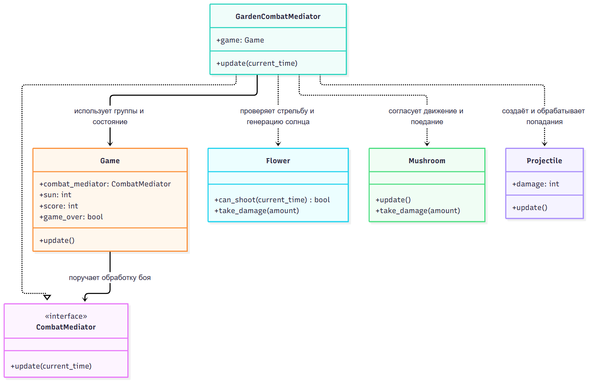
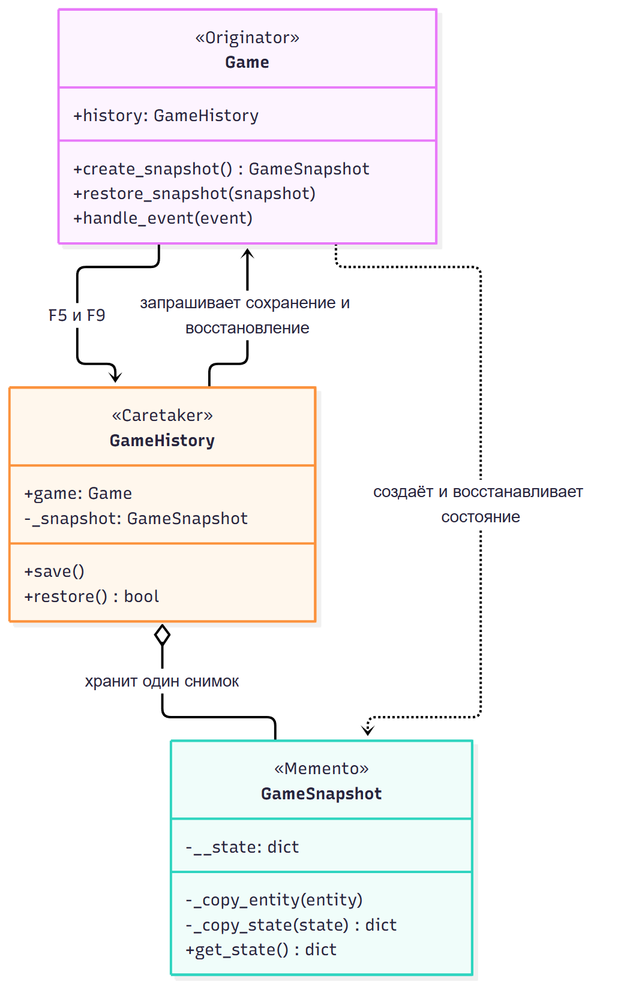

# Отчёт по лабораторной работе № 9

**Тема:** поведенческие паттерны «Посредник» и «Снимок»

## Цель работы

Реализовать решение задачи из предметной области в соответствии с вариантами (пп. 1.4) с использованием паттернов из списка: «Посредник», «Снимок».

## Вариант 16. Игра «Цветы против грибов»

Цель игры - не допустить прохода злых грибов, пытающихся захватить земли добрых растений, с помощью посадки защитных цветов.

**Технологии:** Python 3.13.15, Pygame 2.6.1.

## Ход работы

### Паттерн «Посредник»

**Теория.** Посредник определяет, как несколько объектов взаимодействуют друг с другом. Участники передают ему запросы или уведомления, а он координирует их действия. Правила взаимодействия собраны в одном месте, поэтому участникам достаточно знать посредника.

Во время боя растения, грибы и снаряды участвуют в нескольких связанных действиях. Роза стреляет при наличии гриба в своём ряду, подсолнух пополняет запас солнца, гриб останавливается перед цветком и наносит ему урон, а попадание снаряда уменьшает здоровье гриба и может принести игроку очки. Правила этих взаимодействий объединены в посреднике `GardenCombatMediator`, реализующем интерфейс `CombatMediator`.

Посредник получает доступ к группам сущностей и состоянию игры через ссылку на `Game`. Он ищет цели, создаёт снаряды, проверяет столкновения, передаёт урон и изменяет общие показатели. Сущности предоставляют свои характеристики и операции, а посредник согласует их использование. Это позволяет изменять правила взаимодействия в одном месте.

Игровой цикл вызывает `combat_mediator.update(current_time)`. Создание новых грибов по таймеру, удаление погибших сущностей и отрисовка остаются отдельными этапами цикла.



*Рисунок 1 - Диаграмма классов паттерна «Посредник».*

Исходник Mermaid: [mediator-class-diagram.mmd](../assets/mediator-class-diagram.mmd).

**Листинг 1 - Интерфейс посредника и координация боя.**

```python
class CombatMediator:
    """Интерфейс координации взаимодействий участников боя."""
    def update(self, current_time):
        raise NotImplementedError


class GardenCombatMediator(CombatMediator):
    """Согласует стрельбу, генерацию солнца, поедание и попадания."""
    def __init__(self, game):
        self.game = game

    def update(self, current_time):
        # Обновление сущностей
        for entity in self.game.entities:
            if isinstance(entity, Flower):
                entity.update(current_time, self.game.projectiles)
                if isinstance(entity, SunFlower) and current_time - entity.resource_gen_time >= 6:
                    self.game.sun += 25
                    entity.resource_gen_time = current_time
            elif not isinstance(entity, Mushroom):
                entity.update()
            
            # Стрельба цветов
            if isinstance(entity, Flower) and entity.damage > 0 and entity.can_shoot(current_time):
                # Проверяем, есть ли гриб на этой линии
                has_target = any(isinstance(e, Mushroom) and e.row == entity.row and e.x > entity.x for e in self.game.entities)
                if has_target:
                    proj = Projectile(
                        entity.x + entity.width,
                        entity.y + entity.height // 2,
                        entity.row,
                        entity.damage,
                        renderer=self.game.renderer,
                    )
                    self.game.projectiles.append(proj)
                    entity.last_shot_time = current_time

            # Движение и поедание грибов
            if isinstance(entity, Mushroom):
                # Проверка столкновения с цветком
                current_col = int((entity.x - GRID_OFFSET_X) // CELL_SIZE)
                flower_in_cell = self.game.grid[entity.row][current_col] if 0 <= current_col < GRID_COLS else None
                if flower_in_cell and entity.get_rect().colliderect(flower_in_cell.get_rect()):
                    entity.is_eating = True
                    flower_in_cell.take_damage(0.5) # Гриб ест цветок
                    if not flower_in_cell.is_alive:
                        self.game.grid[entity.row][current_col] = None
                else:
                    entity.is_eating = False
                    entity.update()

                # Проверка проигрыша
                if entity.x < GRID_OFFSET_X:
                    self.game.game_over = True

        # Обновление снарядов
        for proj in self.game.projectiles:
            proj.update()

        # Коллизии снарядов и грибов
        for proj in self.game.projectiles:
            if not proj.is_alive: continue
            for entity in self.game.entities:
                if isinstance(entity, Mushroom) and entity.row == proj.row:
                    if proj.get_rect().colliderect(entity.get_rect()):
                        entity.take_damage(proj.damage)
                        proj.is_alive = False
                        if not entity.is_alive:
                            self.game.score += 10
                        break
```

**Листинг 2 - Использование посредника в игровом цикле.**

```python
class Game:
    def __init__(self):
        # ... Инициализация окна и остальных сервисов ...
        self.combat_mediator = GardenCombatMediator(self)
        # ... Инициализация хранителя снимков и игрового состояния ...

    def update(self):
        if self.game_over:
            return
        current_time = time.time()
        # ... Создание грибов по таймеру ...
        self.combat_mediator.update(current_time)
        self.entities.remove_dead()
        self.projectiles = [p for p in self.projectiles if p.is_alive]
```

### Паттерн «Снимок»

**Теория.** Снимок сохраняет внутреннее состояние объекта на определённый момент, чтобы его можно было восстановить позже. Сам объект создаёт снимок и восстанавливает из него своё состояние. Хранитель сохраняет и передаёт снимок целиком, поэтому ему достаточно знать, как его получить и вернуть.

Игрок может сохранить текущую ситуацию на поле клавишей **F5** и вернуться к ней клавишей **F9**. Снимок включает растения, грибов, снаряды, прототипы грибов, здоровье и координаты сущностей, количество солнца, очки, выбранное растение, признак окончания игры, параметры появления грибов и состояние генератора случайных чисел.

Роли паттерна распределены следующим образом:

- `Game` - создатель состояния (Originator). Он формирует снимок и восстанавливает из него игровое поле.
- `GameSnapshot` - снимок (Memento). Он хранит закрытую копию состояния и возвращает независимые данные для восстановления.
- `GameHistory` - хранитель (Caretaker). Он хранит один снимок и обращается к методам игры для сохранения и восстановления, не анализируя содержимое снимка.

Сущности копируются при сохранении и при каждом восстановлении. Для декоратора усиленной розы создаётся новая обёртка с копией исходного цветка. Текстуры и реализация отрисовки используются совместно, а изменяемые характеристики каждого объекта копируются. Поэтому дальнейшая игра не изменяет сохранённое состояние, и один снимок можно восстановить несколько раз.

При загрузке игра заново связывает растения с клетками сетки и группой растений. Время последнего выстрела, генерации солнца и появления гриба сдвигается на интервал между сохранением и восстановлением. Так оставшееся время ожидания продолжается с сохранённого момента. Снимок хранится в оперативной памяти до закрытия программы; повторное нажатие F5 заменяет его. Нажатие F9 до первого сохранения выводит подсказку. Восстановление доступно также после проигрыша и перезапуска партии.



*Рисунок 2 - Диаграмма классов паттерна «Снимок».*

Исходник Mermaid: [memento-class-diagram.mmd](../assets/memento-class-diagram.mmd).

**Листинг 3 - Снимок состояния и его хранитель.**

```python
class GameSnapshot:
    """Хранит независимую копию игрового состояния в памяти."""
    def __init__(self, state):
        self.__state = self._copy_state(state)

    @staticmethod
    def _copy_entity(entity):
        if isinstance(entity, FlowerDecorator):
            return type(entity)(GameSnapshot._copy_entity(entity._flower))
        # Координаты и характеристики копируются, текстура и renderer общие.
        return copy.copy(entity)

    @classmethod
    def _copy_state(cls, state):
        result = dict(state)
        for key in ("plants", "mushrooms", "projectiles", "prototypes"):
            result[key] = [cls._copy_entity(e) for e in state[key]]
        return result

    def get_state(self):
        # Каждое восстановление получает новые экземпляры сущностей.
        return self._copy_state(self.__state)


class GameHistory:
    """Хранитель одного снимка; не разбирает его содержимое."""
    def __init__(self, game):
        self.game = game
        self._snapshot = None

    def save(self):
        self._snapshot = self.game.create_snapshot()

    def restore(self):
        if self._snapshot is None:
            return False
        self.game.restore_snapshot(self._snapshot)
        return True
```

**Листинг 4 - Создание и восстановление снимка в игре.**

```python
class Game:
    # ... Инициализация, обработка событий и остальные методы ...

    def create_snapshot(self):
        return GameSnapshot({
            "plants": list(self.plant_group),
            "mushrooms": list(self.mushroom_group),
            "projectiles": self.projectiles,
            "prototypes": self.mushroom_prototypes,
            "score": self.score,
            "sun": self.sun,
            "selected_flower": self.selected_flower,
            "game_over": self.game_over,
            "last_spawn_time": self.last_spawn_time,
            "spawn_interval": self.spawn_interval,
            "saved_at": time.time(),
            "random_state": random.getstate(),
        })

    def restore_snapshot(self, snapshot):
        state = snapshot.get_state()
        time_shift = time.time() - state["saved_at"]
        self.grid = [[None for _ in range(GRID_COLS)] for _ in range(GRID_ROWS)]
        self.entities = EntityGroup()
        self.plant_group = EntityGroup()
        self.mushroom_group = EntityGroup()
        self.entities.add(self.plant_group)
        self.entities.add(self.mushroom_group)
        for plant in state["plants"]:
            plant.last_shot_time += time_shift
            if isinstance(plant, SunFlower):
                plant.resource_gen_time += time_shift
            self.plant_group.add(plant)
            self.grid[plant.row][plant.col] = plant
        for mushroom in state["mushrooms"]:
            self.mushroom_group.add(mushroom)
        self.projectiles = state["projectiles"]
        self.mushroom_prototypes = state["prototypes"]
        self.score = state["score"]
        self.sun = state["sun"]
        self.selected_flower = state["selected_flower"]
        self.game_over = state["game_over"]
        self.last_spawn_time = state["last_spawn_time"] + time_shift
        self.spawn_interval = state["spawn_interval"]
        random.setstate(state["random_state"])
```

**Листинг 5 - Сохранение и загрузка по клавишам.**

```python
class Game:
    def __init__(self):
        # ... Инициализация остальных сервисов ...
        self.history = GameHistory(self)
        self.reset_game()

    def handle_event(self, event):
        if event.type == pygame.KEYDOWN:
            if event.key == pygame.K_F5:
                self.history.save()
                self.snapshot_message = "Снимок сохранён"
                return
            if event.key == pygame.K_F9:
                restored = self.history.restore()
                self.snapshot_message = (
                    "Снимок восстановлен" if restored else "Сначала сохраните снимок (F5)"
                )
                return
        # ... Обработка посадки и выбора растения ...
```

## Вывод

В игре «Посредник» координирует взаимодействия участников боя, а «Снимок» сохраняет состояние партии и позволяет вернуться к нему.
