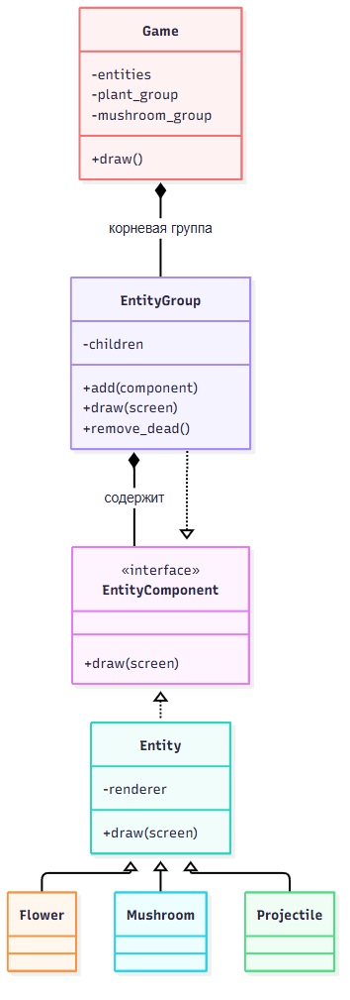

# Отчёт по лабораторной работе № 1

**Тема** — тестирование чёрного и белого ящика

## Цель работы

Изучить тестирование белого ящика и применить его к игровому приложению.

## Вариант 16. Игра «Цветы против грибов»

**Технологии** — Python 3.13.15, Pygame 2.6.1, unittest.

## Ход работы

### Тестирование белого ящика

При тестировании белого ящика тесты составляются с учётом внутреннего устройства программы. Изучаются условия и ветви кода, затем подбираются входные данные для проверки их выполнения.

Для проверки выбран метод `Game.try_plant_flower`. Он определяет клетку по координатам нажатия, проверяет границы поля, занятость клетки и количество солнца, затем создаёт растение выбранного типа. Стратегия проверки — пройти истинные и ложные исходы этих условий, включая границы координат и стоимости.

### Диаграмма классов



Рисунок 1 - Основные классы игры. 

### Исходный код тестов

Каждый тест создаёт новую игру. В проверках используются настоящий метод посадки и текстуры игры. Для запуска без открытия окна установлен драйвер SDL `dummy`.

**Листинг 1. Проверка посадки в занятую клетку.**

```python
class WhiteBoxTests(unittest.TestCase):
    def setUp(self):
        self.game = main.Game()

    def tearDown(self):
        pygame.quit()

    def plant(self, kind="rose", row=0, col=0):
        self.game.selected_flower = kind
        self.game.try_plant_flower((50 + col * 60, 80 + row * 60))
        return self.game.grid[row][col]

    def test_W06_occupied_cell(self):
        flower = self.plant()
        self.assertIs(self.plant("sunflower"), flower)
        self.assertEqual(self.game.sun, 50)
        self.assertEqual(list(self.game.plant_group), [flower])
```


### Результаты тестирования

Поле занимает область от (50, 80) включительно до (590, 380) исключительно. Каждый сценарий начинается с новой игры.

| Проверка | Входные данные | Ожидаемый результат | Фактический результат |
| --- | --- | --- | --- |
| Посадка розы | Солнце 50, точка (50, 80) | Роза в клетке (0, 0), остаток 0 | Совпадает |
| Посадка подсолнуха | Солнце 25, точка (50, 80) | Подсолнух в клетке, остаток 0 | Совпадает |
| Посадка усиленной розы | Солнце 75, точка (50, 80) | Усиленная роза с уроном 50, остаток 0 | Совпадает |
| Недостаток ресурсов | Для каждого типа запас на 1 меньше цены | Клетка пуста, солнце сохранено | Совпадает |
| Занятая клетка | Повторная посадка в (0, 0) | Исходное растение сохранено, повторного списания нет | Совпадает |
| Выход за поле | (49, 80), (590, 80), (50, 79), (50, 380) | Посадка отклонена, солнце сохранено | Совпадает |
| Последний пиксель поля | (589, 379) | Роза в клетке (4, 8), остаток 50 | Совпадает |

Проверены оба исхода пяти решений метода посадки — допустимость координат, свободная клетка, недостаток ресурсов, выбор розы и выбор подсолнуха. Ветка усиленной розы выполняется после исключения двух других типов.

