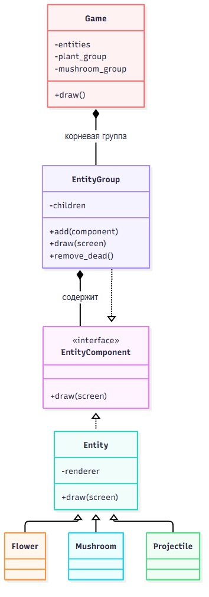

# Отчёт по лабораторной работе № 2

**Тема** - ручное и автоматизированное тестирование

## Цель работы

Изучить автоматизированное тестирование и применить его к игровому приложению.

## Вариант 16. Игра «Цветы против грибов»

**Технологии** - Python 3.13.15, Pygame 2.6.1, unittest.

## Ход работы

### Автоматизированное тестирование

Автоматизированное тестирование выполняется программой, которая подготавливает входные данные, запускает действия и сравнивает результат с ожидаемым. Тесты можно повторять после изменений приложения. В unittest проверки оформляются методами класса TestCase, а сравнение результатов выполняется утверждениями assert.

Для работы выбраны обработка клавиатуры и мыши, повторная посадка, блокировка действий после поражения и сброс игры. Тесты создают события Pygame и передают их методу `Game.handle_event`. После выполнения проверяются растения на поле и количество ресурсов. Сброс состояния проверяется вызовом `Game.reset_game`.

### Диаграмма классов



*Рисунок 1 - Основные классы игры. Game обрабатывает действия игрока и управляет группами игровых объектов.*

### Исходный код тестов

Перед каждым тестом метод `setUp` создаёт новую игру, после выполнения `tearDown` завершает Pygame. Драйвер SDL `dummy` позволяет выполнять проверки без открытия окна. Используются настоящие игровые классы и текстуры.

**Листинг 1. Автоматическая проверка повторного нажатия.**

```python
def click(self, button=1):
    event = pygame.event.Event(
        pygame.MOUSEBUTTONDOWN, button=button, pos=(50, 80)
    )
    self.game.handle_event(event)

def test_repeated_click(self):
    self.click()
    flower = self.game.grid[0][0]
    self.click()
    self.assertIs(self.game.grid[0][0], flower)
    self.assertEqual(self.game.sun, 50)
    self.assertEqual(list(self.game.plant_group), [flower])
```

Первое нажатие сажает розу и расходует 50 единиц солнца. Второе нажатие в ту же клетку должно сохранить растение и остаток ресурсов.

### Результаты тестирования

| Проверка | Входные данные и действия | Ожидаемый результат | Фактический результат |
| --- | --- | --- | --- |
| Выбор и посадка | Клавиши 1, 2, 3, затем левое нажатие в (50, 80), отдельная игра для каждого типа | Соответствующее растение в клетке (0, 0), остаток солнца 50, 75 и 25 | Совпадает |
| Правая кнопка мыши | Правое нажатие в (50, 80) | Поле пустое, солнце 100 | Совпадает |
| Повторная посадка | Два левых нажатия в (50, 80) | Одна роза, солнце 50 | Совпадает |
| Действия после поражения | game_over=True, клавиша 2 и левое нажатие | Выбор rose сохранён, поле пустое, солнце 100 | Совпадает |
| Сброс игры | Растение, гриб, снаряд, очки 30, поражение, вызов reset_game | Поле и объекты очищены, солнце 100, очки 0, выбрана роза, игра активна | Совпадает |

