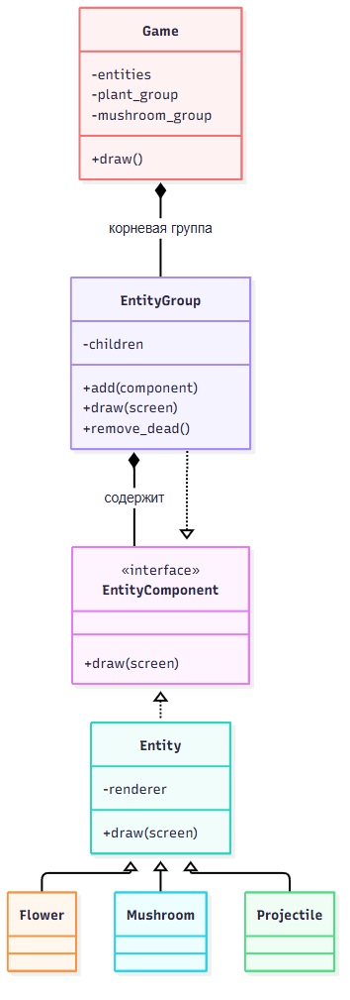

# Отчёт по лабораторной работе № 3

**Тема** - функциональное тестирование

## Цель работы

Изучить интеграционное тестирование и проверить взаимодействие компонентов игрового приложения.

## Вариант 16. Игра «Цветы против грибов»

**Технологии** - Python 3.13.15, Pygame 2.6.1, unittest.

## Ход работы

### Интеграционное тестирование

Функциональное тестирование проверяет соответствие поведения приложения его требованиям. В работе выбрано интеграционное тестирование - проверка совместной работы нескольких компонентов и передачи данных между ними.

По правилам игры выделены пять сценариев взаимодействия. Проверяются передача урона от растения снаряду, попадание в гриба, начисление очков и удаление погибших объектов. Дополнительно проверяются выбор цели по ряду, использование произведённого солнца и повторная посадка после гибели цветка.

### Диаграмма классов



*Рисунок 1 - Взаимодействующие классы игры. Game связывает растения Flower, снаряды Projectile и грибы Mushroom, а EntityGroup удаляет погибшие объекты.*

### Исходный код тестов

Каждый тест создаёт отдельную игру с настоящими классами и текстурами. Проверка выполняется через `Game.update`, который обрабатывает стрельбу, движение и столкновения. Время фиксируется на значении 1000 с, поэтому дополнительные грибы по таймеру не появляются. Драйвер SDL `dummy` позволяет выполнять тесты без открытия окна.

**Листинг 1. Проверка передачи усиленного урона через снаряд.**

```python
def test_empowered_damage_reaches_projectile(self):
    flower = self.plant("empowered_rose")
    mushroom = main.Mushroom(0, health=50)
    mushroom.x = 120
    self.game.mushroom_group.add(mushroom)
    self.game.update()
    self.assertEqual(flower.damage, 50)
    self.assertEqual(mushroom.health, 0)
    self.assertFalse(mushroom.is_alive)
    self.assertEqual(self.game.score, 10)
    self.assertEqual(self.game.projectiles, [])
    self.assertEqual(list(self.game.mushroom_group), [])
```

Вспомогательный метод `plant` выбирает растение и вызывает `Game.try_plant_flower`. Усиленная роза создаётся через фабрику и декоратор. Во время обновления она выпускает снаряд, который попадает в расположенного рядом гриба. Проверяется итог всей цепочки - здоровье, очки и очистка объектов.


### Результаты тестирования

| Проверка | Входные данные и действия | Ожидаемый результат | Фактический результат |
| --- | --- | --- | --- |
| Роза → снаряд → гриб | Роза в (0, 0), гриб того же ряда с x=200 и здоровьем 25, последовательные обновления | Снаряд наносит 25 урона, гриб погибает, очки 10, гриб и снаряд удалены | Совпадает |
| Усиленный урон | Усиленная роза, гриб того же ряда с x=120 и здоровьем 50, одно обновление | Гриб уничтожен одним снарядом, очки 10, объекты попадания удалены | Совпадает |
| Цель в другом ряду | Роза в ряду 0, гриб в ряду 1, обновление | Снаряды отсутствуют, здоровье гриба 100, очки 0 | Совпадает |
| Генерация и расход солнца | Подсолнух и усиленная роза расходуют начальные 100 солнца, затем проходит интервал генерации 6 с | Получено 25 солнца, на них посажен второй подсолнух, остаток 0, растений 3 | Совпадает |
| Освобождение клетки | Роза со здоровьем 0,5, гриб пересекает её, обновление и новая посадка | Погибшая роза удалена из поля и группы, в клетку посажена новая роза, остаток солнца 0 | Совпадает |

